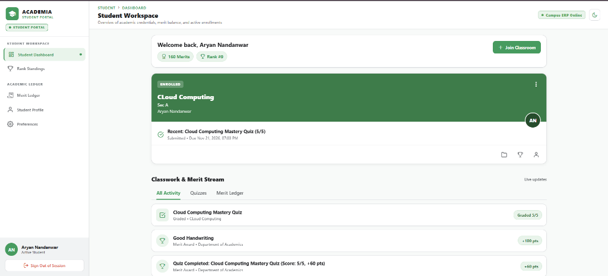
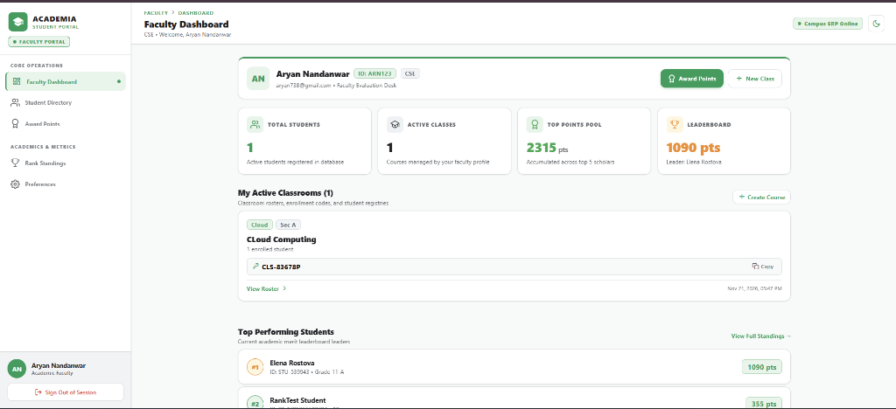

# Student Management System (SMS)

An end-to-end academic merit, evaluation, and student management platform featuring a **Spring Boot 3.x** RESTful backend, **PostgreSQL** relational database persistence, and a **React Native (Expo SDK 58)** cross-platform mobile and web application powered by **Redux Toolkit** and the **Google Classroom** design system.

---

## Table of Contents

1. [Project Overview](#1-project-overview)
2. [Technical Stack & Architecture](#2-technical-stack--architecture)
3. [Functional Requirements Implementation](#3-functional-requirements-implementation)
   - [Authentication & Role-Based Access Control (RBAC)](#31-authentication--role-based-access-control-rbac)
   - [Frontend State Architecture, Redux & Providers](#32-frontend-state-architecture-redux--providers)
   - [Student Leaderboard, Quizzes & Point Mechanics](#33-student-leaderboard-quizzes--point-mechanics)
4. [Backend & Database Specifications](#4-backend--database-specifications)
   - [Database Persistence & Flyway Migrations](#41-database-persistence--flyway-migrations)
   - [Server-Side Pagination & Sorting](#42-server-side-pagination--sorting)
   - [REST API Design & Endpoints](#43-rest-api-design--endpoints)
   - [Validation & Centralized Exception Handling](#44-validation--centralized-exception-handling)
5. [User Interface Design & Role-Based Dashboards](#5-user-interface-design--role-based-dashboards)
   - [Student Workspace & Dashboard](#51-student-workspace--dashboard)
   - [Faculty & Teacher Dashboard](#52-faculty--teacher-dashboard)
   - [Design System & Google Classroom Theming](#53-design-system--google-classroom-theming)
6. [Project Structure](#6-project-structure)
7. [Setup & Execution Instructions](#7-setup--execution-instructions)
   - [Method A: Running via Docker Compose (Recommended)](#method-a-running-via-docker-compose-recommended)
   - [Method B: Running Locally with Maven & Expo Go](#method-b-running-locally-with-maven--expo-go)
8. [Live Demonstration Walkthrough](#8-live-demonstration-walkthrough)

---

## 1. Project Overview

The **Student Management System** is designed to manage student academic performance, recognize positive classroom behavior, reward extracurricular participation, and motivate students through dynamic gamified rankings and automated classroom assessments.

### Key Capabilities:
- **Dual User Roles**: 
  - **`TEACHER`**: Faculty administration portal to browse students, award merit points or penalty deductions, generate quizzes for classes, review submissions, and manage classrooms.
  - **`STUDENT`**: Google Classroom workspace to view enrolled subjects, take assigned quizzes, view verified merit balances, inspect peer competition standings, and audit transaction histories.
- **Dynamic Leaderboard**: Server-side standard competition ranking based on verified student merit points (`RANK() DESC`) with deterministic tie resolution and 3-tier podium visualization.
- **Pessimistic Concurrency Locking**: Database-level write locking on student point records prevents race conditions and balance discrepancies during concurrent point awards by multiple faculty members.
- **End-to-End Quiz Engine**: Teachers author quizzes with point values and deadlines; students take interactive tests from their classwork stream; the backend automatically scores submissions and allocates academic merit points that immediately update rankings.

---

## 2. Technical Stack & Architecture

### Backend
- **Framework**: Spring Boot 3.3.5
- **Language**: Java 17+
- **Security**: Spring Security 6 with stateless Bearer JWT (JJWT 0.12.6) & BCrypt password hashing
- **Data Access**: Spring Data JPA & Hibernate 6.5
- **Database Engine**: PostgreSQL 16 / 18
- **Schema Management**: Flyway Database Migrations (`V1`, `V2`, `V3`)
- **Validation**: Hibernate Validator (Bean Validation API / JSR-380)
- **Build Tool**: Apache Maven 3.9+

### Frontend (Mobile & Web)
- **Framework**: React Native 0.88 with Expo SDK 58
- **Language**: TypeScript 5.3+
- **State Management**: Redux Toolkit (`@reduxjs/toolkit` & `react-redux`)
- **Navigation & Routing**: React Navigation 6 (Native Stack, Bottom Tabs, Browser Deep Linking)
- **Session Persistence**: Expo SecureStore (encrypted on physical devices) / `localStorage` (Web)
- **Global Theme Engine**: React Context API (`ThemeContext`) with dynamic light/dark tokens
- **HTTP Client**: Axios with dynamic IP resolution and JWT authorization interceptors
- **Forms & Validation**: React Hook Form with Zod schema resolution
- **Design System**: Google Classroom theme (`#0F9D58` primary green, `#E6F4EA` light green, `#F8FAF9` surface)

### Architecture Diagram

```
+--------------------------------------------------------------------------+
|                        React Native Expo Client                          |
|             (Physical Android / iOS via Expo Go OR Web Browser)          |
+--------------------------------------------------------------------------+
       |                                                    |
       | Redux Toolkit (authSlice, leaderboardSlice)        | ThemeContext
       | Local Persistence (SecureStore / localStorage)     | Light / Dark Mode
       v                                                    v
+--------------------------------------------------------------------------+
|                     Axios HTTP Client with JWT Token                     |
+--------------------------------------------------------------------------+
                                    | REST (HTTP / JSON)
                                    v
+--------------------------------------------------------------------------+
|                       Spring Boot 3.x REST API                           |
|  +--------------------------------------------------------------------+  |
|  | Spring Security Filter Chain (JwtAuthenticationFilter & CORS)     |  |
|  +--------------------------------------------------------------------+  |
|  | Controller Layer (@RestController, @Valid, @PreAuthorize)          |  |
|  | - AuthController       - StudentController   - PointController     |  |
|  | - LeaderboardController- ClassController     - QuizController      |  |
|  +--------------------------------------------------------------------+  |
|  | Service Layer (@Service, @Transactional)                           |  |
|  | - AuthService          - StudentService      - PointService        |  |
|  | - LeaderboardService   - ClassService        - QuizService         |  |
|  +--------------------------------------------------------------------+  |
|  | Centralized Error Handling (@RestControllerAdvice)                 |  |
|  +--------------------------------------------------------------------+  |
|  | Repository Layer (Spring Data JPA Repositories & Projections)      |  |
|  | - Pessimistic Write Locking (@Lock(LockModeType.PESSIMISTIC_WRITE))|  |
|  +--------------------------------------------------------------------+  |
+--------------------------------------------------------------------------+
                                    | JDBC Connection
                                    v
+--------------------------------------------------------------------------+
|                       PostgreSQL Relational Database                     |
|  - users                  - student_profiles      - teacher_profiles     |
|  - point_transactions     - classes               - class_enrollments    |
|  - quizzes                - quiz_questions        - quiz_submissions     |
+--------------------------------------------------------------------------+
```

---

## 3. Functional Requirements Implementation

### 3.1 Authentication & Role-Based Access Control (RBAC)

1. **Registration & Sign-Up**:
   - Students register with Name, Email, Password, Student ID number, and Grade Level.
   - Teachers register with Name, Email, Password, Employee ID, Department, and a secure `TEACHER_INVITATION_CODE`.
2. **Authentication & Session Issuance**:
   - Credentials verified against PostgreSQL using BCrypt password hashing.
   - On success, the backend returns a signed HMAC-SHA256 JWT payload containing user profile data and designated role (`STUDENT` or `TEACHER`).
3. **Role-Segregated Interfaces & Protected Flows**:
   - `STUDENT`: Read-only access to merit totals, peer standings, classwork stream, and personal student profile.
   - `TEACHER`: Administrative access to directory, point awards, quiz generation, and classroom management.
   - Unauthorized attempts return `401 Unauthorized` or `403 Forbidden`.
4. **Deep-Linked Routing**:
   - Deep-linked routes synchronized with browser history and navigation state:
     - `/login`, `/register`
     - `/faculty-dashboard`, `/student-directory`, `/award-points`, `/rank-standings`, `/preferences`
     - `/dashboard`, `/merit-ledger`, `/student-profile`

### 3.2 Frontend State Architecture, Redux & Providers

1. **Centralized Redux Store**:
   - `authSlice`: Handles login, registration, active token lifecycle, user profile caching, and session clearing on logout.
   - `leaderboardSlice`: Manages rank list fetching, pagination state, page indices, and immediate updates upon point distribution.
   - `createAsyncThunk`: Handles asynchronous REST calls with pending, fulfilled, and rejected lifecycle actions.
2. **Persistent Storage Sync**:
   - Device persistence via `Expo SecureStore` on mobile and `localStorage` on web.
   - Active tokens and profile states survive browser refreshes, application reloads, and mobile process restarts.
3. **Global Theme Management (Day / Night Mode)**:
   - Dedicated `ThemeContext` providing custom Google Classroom light and high-contrast dark themes.
   - Instant UI toggle switch in Preferences (`SettingsScreen`) and responsive sidebar updates all screens immediately.

### 3.3 Student Leaderboard, Quizzes & Point Mechanics

1. **Dynamic Competition Ranking**:
   - Calculated dynamically at the database layer using SQL window functions:
     ```sql
     RANK() OVER (ORDER BY sp.total_points DESC, sp.id ASC)
     ```
   - Handles ties deterministically and assigns standard competition rankings (`#1`, `#1`, `#3`).
2. **Student Read-Only View & Podium**:
   - Features an architectural 3-tier podium for top performers:
     - `#1 GOLD` (center pedestal with trophy icon)
     - `#1 / #2 SILVER` (left pedestal with medallion icon)
     - `#1 / #3 BRONZE` (right pedestal with medallion icon)
   - Highlights the authenticated student's relative position with a dedicated `YOU` badge.
3. **Teacher Point Award Flow**:
   - Teachers select students, pick or enter custom points (positive rewards or negative penalties), select category (`ACADEMIC`, `PARTICIPATION`, `BEHAVIOR`, `PENALTY`, `ADJUSTMENT`), and provide an audit reason.
   - Point awards execute in an isolated database transaction with pessimistic write locking, updating total points and creating an immutable `PointTransaction` record.
4. **Integrated Classroom Quizzes**:
   - Teachers generate quizzes assigned to classrooms with custom question options and point rewards.
   - Students take quizzes through their Classwork & Merit Stream.
   - Automated grading verifies correct options and awards merit points immediately to the student's tally.

---

## 4. Backend & Database Specifications

### 4.1 Database Persistence & Flyway Migrations

The database schema is fully normalized and managed via automated Flyway migrations:
- **`V1__initial_schema.sql`**:
  - `users`: Core identity table (id, email, password_hash, first_name, last_name, role, created_at, updated_at).
  - `student_profiles`: One-to-one with users (student_id_number, grade_level, total_points).
  - `teacher_profiles`: One-to-one with users (employee_id_number, department).
  - `point_transactions`: Immutable log of points awarded/deducted with foreign keys to student and teacher.
- **`V2__class_schema.sql`**:
  - `classes`: Classroom entities (class_name, section, enrollment_code, teacher_id).
  - `class_enrollments`: Student-to-class enrollments with unique constraint on `(class_id, student_id)`.
- **`V3__quiz_schema.sql`**:
  - `quizzes`: Classroom assessment records (title, description, point_value, class_id).
  - `quiz_questions`: Multiple-choice questions (question_text, option_a, option_b, option_c, option_d, correct_option).
  - `quiz_submissions`: Submission history and earned scores with unique constraint on `(quiz_id, student_id)`.

### 4.2 Server-Side Pagination & Sorting

The backend implements server-side pagination and dynamic sorting using Spring Data JPA (`Pageable`, `PageRequest`):
- Accepts client-controlled parameters: `page` (zero-indexed), `size` (page limit), `sortBy`, and `sortDirection`.
- Returns paginated envelopes containing metadata:
  ```json
  {
    "content": [...],
    "page": 0,
    "size": 20,
    "totalElements": 85,
    "totalPages": 5,
    "last": false
  }
  ```

### 4.3 REST API Design & Endpoints

All endpoints follow RESTful conventions, prefixed with `/api/v1`:

#### Authentication (`/api/v1/auth`)
| Method | Endpoint | Access | Description |
| :--- | :--- | :--- | :--- |
| `POST` | `/api/v1/auth/register` | Public | Register a student or teacher account |
| `POST` | `/api/v1/auth/login` | Public | Verify credentials and receive JWT token |
| `GET` | `/api/v1/auth/me` | Authenticated | Retrieve authenticated user profile |

#### Student Directory (`/api/v1/students`)
| Method | Endpoint | Access | Description |
| :--- | :--- | :--- | :--- |
| `GET` | `/api/v1/students` | `TEACHER` only | Paginated search of all student profiles |
| `GET` | `/api/v1/students/{id}` | `TEACHER` or Owner | Retrieve student profile details |
| `GET` | `/api/v1/students/me/profile` | `STUDENT` only | Retrieve personal student profile |
| `GET` | `/api/v1/students/{id}/transactions` | `TEACHER` or Owner | Retrieve paginated merit transaction history |

#### Points & Merit Allocation (`/api/v1/points`)
| Method | Endpoint | Access | Description |
| :--- | :--- | :--- | :--- |
| `POST` | `/api/v1/points/award` | `TEACHER` only | Award or adjust points for a student |
| `GET` | `/api/v1/points/types` | Authenticated | List valid transaction categories |

#### Institutional Leaderboard (`/api/v1/leaderboard`)
| Method | Endpoint | Access | Description |
| :--- | :--- | :--- | :--- |
| `GET` | `/api/v1/leaderboard` | Authenticated | Retrieve paginated standard competition rankings |

#### Classrooms & Enrollments (`/api/v1/classes`)
| Method | Endpoint | Access | Description |
| :--- | :--- | :--- | :--- |
| `POST` | `/api/v1/classes` | `TEACHER` only | Create a new classroom |
| `GET` | `/api/v1/classes/teaching` | `TEACHER` only | List classrooms taught by teacher |
| `GET` | `/api/v1/classes/enrolled` | `STUDENT` only | List classrooms joined by student |
| `POST` | `/api/v1/classes/join` | `STUDENT` only | Join a classroom using enrollment code |

#### Quizzes & Assessments (`/api/v1/quizzes`)
| Method | Endpoint | Access | Description |
| :--- | :--- | :--- | :--- |
| `POST` | `/api/v1/quizzes` | `TEACHER` only | Create a quiz with multiple-choice questions |
| `GET` | `/api/v1/quizzes/class/{classId}` | Authenticated | List all quizzes for a classroom |
| `GET` | `/api/v1/quizzes/student/pending` | `STUDENT` only | List active assigned quizzes for student |
| `POST` | `/api/v1/quizzes/{quizId}/submit` | `STUDENT` only | Submit quiz answers, auto-grade & award points |

### 4.4 Validation & Centralized Exception Handling

1. **Request Body Validation**:
   - Enforced using `@Valid` with JSR-380 annotations (`@NotNull`, `@NotBlank`, `@Email`, `@Size`, `@Min`, `@Max`).
2. **Centralized Error Handling**:
   - Implemented via `@RestControllerAdvice` in `GlobalExceptionHandler.java`.
   - Maps errors into structured, predictable JSON error payloads:
     ```json
     {
       "success": false,
       "status": 400,
       "error": "Bad Request",
       "message": "Validation failed for one or more fields",
       "path": "/api/v1/points/award",
       "timestamp": 1795270120.123,
       "validationErrors": {
         "points": "Points amount must not be zero",
         "reason": "Reason is required"
       }
     }
     ```

---

## 5. User Interface Design & Role-Based Dashboards

The application is built around the **Google Classroom visual language** (`#0F9D58` primary green, `#E6F4EA` light green, `#F8FAF9` background), delivering distinct, role-segregated dashboard experiences for students and teachers.

---

### 5.1 Student Workspace & Dashboard

The **Student Dashboard** serves as the learner's centralized academic portal, offering real-time visibility into active classrooms, personal merit balances, dynamic standings, and incoming coursework.



#### Student Dashboard Architecture & Features:
1. **Header & Contextual Breadcrumbs**:
   - Dynamic path indicator (`STUDENT > DASHBOARD`).
   - System health badge (`● Campus ERP Online`) providing connectivity feedback.
   - Quick theme toggle (Light / Dark mode).
2. **Left Navigation Sidebar**:
   - **Student Workspace**: Access to `Student Dashboard` and `Rank Standings`.
   - **Academic Ledger**: Direct links to `Merit Ledger` (point transaction history), `Student Profile` (academic dossier and records), and `Preferences`.
   - **User Session Card**: Bottom-docked identity pill displaying student avatar (`AN`), student full name, role badge (`Active Student`), and a 1-click **Sign Out** button.
3. **Student Overview & Action Banner**:
   - **Welcome Header**: Personalized greeting with student name.
   - **Merit Points Pill**: Verified running balance (`160 Merits`).
   - **Leaderboard Position Pill**: Real-time institutional ranking badge (`Rank #9`).
   - **`+ Join Classroom` Action**: Modal flow allowing students to enter teacher-provided enrollment codes (e.g., `CLS-83678P`) to instantly join course rosters.
4. **Enrolled Classrooms Grid**:
   - Rendered using Google Classroom aesthetic with deep-green course banner headers (`#137333` / `#0F9D58`).
   - Course subject title (e.g., `Cloud Computing`), section (e.g., `Sec A`), and instructor name.
   - Circular teacher initials avatar overlapping banner boundary.
   - Quick-action footer containing shortcuts for course materials, course standings, and instructor profile.
   - **Recent Activity Callout**: Highlights latest classwork submissions and due dates (e.g., `Recent: Cloud Computing Mastery Quiz (5/5) — Submitted`).
5. **Classwork & Merit Stream**:
   - **Filterable Tabs**: Real-time switching between `All Activity`, `Quizzes`, and `Merit Ledger`.
   - **Live Activity Feed**: Interactive chronological stream featuring:
     - **Graded Quizzes**: Shows assessment title, course association, and score badge (e.g., `Graded 5/5`).
     - **Faculty Merit Awards**: Displays recognized achievements (e.g., `Good Handwriting`) with awarded points capsule (`+100 pts`).
     - **Automated Quiz Merits**: Point rewards earned upon assessment completion (e.g., `Quiz Completed: +60 pts`).

---

### 5.2 Faculty & Teacher Dashboard

The **Teacher / Faculty Dashboard** provides an administrative hub tailored for educators to manage course rosters, distribute merit points, review top scholars, and monitor classroom engagement.



#### Teacher Dashboard Architecture & Features:
1. **Header & Department Welcome**:
   - Breadcrumb navigation (`FACULTY > DASHBOARD`).
   - Academic department greeting (e.g., `CSE • Welcome, Aryan Nandanwar`).
   - System status monitor (`● Campus ERP Online`) and global theme switch.
2. **Left Operations Sidebar**:
   - **Core Operations**: Quick navigation to `Faculty Dashboard`, `Student Directory` (searchable student roster), and `Award Points` (point distribution modal).
   - **Academics & Metrics**: Access to `Rank Standings` and `Preferences`.
   - **Faculty Session Card**: Displays instructor avatar, name, `Academic Faculty` designation, and session logout.
3. **Faculty Profile & Action Header**:
   - Instructor identity banner showing employee code (`ID: ARN123`), assigned department (`CSE`), and official evaluation email.
   - **Primary Action Buttons**:
     - `Award Points`: Launches the point distribution screen with student selector, category picker, and pessimistic balance locking.
     - `+ New Class`: Modal trigger to create new courses with auto-generated unique enrollment codes.
4. **Key Performance Indicators (KPIs)**:
   - **Total Students**: Real-time count of active students registered in the academic institution.
   - **Active Classes**: Total courses currently taught and managed by the faculty member.
   - **Top Points Pool**: Aggregate merit tally accumulated across top-ranking scholars (e.g., `2315 pts`).
   - **Leaderboard Spotlight**: Highlighting the current Rank #1 student and highest score (e.g., `Leader: Elena Rostova — 1090 pts`).
5. **My Active Classrooms**:
   - Visual registry of managed classrooms with department and section tags.
   - Enrolled student headcount indicator.
   - **Secure Enrollment Code Capsule**: Prominently displayed unique join key (e.g., `CLS-83678P`) with a 1-click **Copy** button for distribution to students.
   - `View Roster >` link to inspect enrolled student list and grade records.
6. **Top Performing Students Podium**:
   - Mini-leaderboard preview embedded directly into the faculty homepage.
   - Renders top academic performers with gold and silver medal badges (`#1`, `#2`), full student names, unique student IDs, grade levels, and live point balances.
   - Direct link to `View Full Standings →`.

---

### 5.3 Design System & Google Classroom Theming

- **Color Tokens**:
  - Primary Green: `#0F9D58` (Classroom Header & Primary Buttons)
  - Surface Accent: `#E6F4EA` (Active tabs, pill backgrounds, selection highlights)
  - Dark Header Green: `#1E7E44` / `#137333` (Course card hero banners)
  - Backgrounds: `#F8FAF9` (Google Classroom Light Canvas) / `#0E1726` (Deep Obsidian Dark Canvas)
  - Text Hierarchy: `#202124` (High-contrast text) / `#5F6368` (Secondary metadata text)
- **Responsive Card Grid**: Adapts cleanly across mobile screens (single-column swipe view), tablets (2-column grid), and widescreen desktop displays (multi-column Google Classroom grid).

---

## 6. Project Structure

```
Student_Management_System-main/
├── backend/
│   ├── src/main/java/com/sms/
│   │   ├── common/             # GlobalExceptionHandler, ApiResponse, PagedResponse
│   │   ├── config/             # SecurityConfig, CorsConfig
│   │   ├── controller/         # Auth, Student, Point, Leaderboard, Class, Quiz controllers
│   │   ├── dto/                # Request & Response DTOs
│   │   ├── model/
│   │   │   ├── entity/         # User, StudentProfile, TeacherProfile, PointTransaction, Class, Quiz
│   │   │   └── enums/          # Role (STUDENT, TEACHER), TransactionType
│   │   ├── repository/         # Spring Data JPA Repositories
│   │   ├── security/           # JwtTokenProvider, UserPrincipal, JwtAuthenticationFilter
│   │   └── service/            # Business logic (Auth, Student, Point, Leaderboard, Class, Quiz)
│   ├── src/main/resources/
│   │   ├── db/migration/       # Flyway V1, V2, V3 migration scripts
│   │   └── application.yml     # Configuration properties
│   ├── Dockerfile              # Multi-stage production container build
│   └── pom.xml                 # Maven dependencies
│
├── frontend/
│   ├── src/
│   │   ├── api/                # Axios API services (authApi, studentApi, pointApi, quizApi, classApi)
│   │   ├── components/         # Common buttons, cards, modals, layout, podium, quiz components
│   │   ├── context/            # ThemeContext (Light & Dark theme switching)
│   │   ├── features/
│   │   │   ├── auth/           # LoginScreen, RegisterScreen, SplashScreen
│   │   │   ├── student/        # StudentDashboardScreen, StudentProfileScreen, PointHistoryScreen
│   │   │   ├── teacher/        # TeacherDashboardScreen, StudentDirectoryScreen, AwardPointsScreen
│   │   │   ├── leaderboard/    # LeaderboardScreen (Institutional Podium & Standard Competition List)
│   │   │   └── settings/       # SettingsScreen (Theme toggle & server connection configuration)
│   │   ├── navigation/         # RootNavigator, linking.ts (Deep links), StudentNavigator, TeacherNavigator
│   │   ├── store/              # Redux store, authSlice, leaderboardSlice, hooks
│   │   ├── theme/              # Google Classroom color tokens, typography, spacing
│   │   └── utils/              # SecureStore, formatters, environment IP resolution
│   ├── app.json                # Expo application configuration
│   ├── package.json            # Node dependencies
│   ├── Dockerfile              # Nginx production container build
│   └── tsconfig.json           # TypeScript configuration
│
├── docker-compose.yml          # Production multi-container orchestrator (Postgres, Backend, Frontend)
├── run_qa_tests.ps1            # Automated end-to-end integration test suite
└── README.md                   # Master Documentation
```

---

## 7. Setup & Execution Instructions

### Method A: Running via Docker Compose (Recommended)

To start the entire full-stack system in Docker:

```powershell
docker compose up -d --build
```

- **Frontend Web Application**: `http://localhost:8081`
- **Backend Spring Boot API**: `http://localhost:8080/api/v1`
- **PostgreSQL Database**: Port `5432`

---

### Method B: Running Locally with Maven & Expo Go

#### 1. Start the Database
Ensure PostgreSQL is running locally on port `5432` with a database named `sms_db`.

#### 2. Start the Backend
```powershell
cd backend
mvn clean package -DskipTests
java -jar target/student-management-system-1.0.0.jar
```
*(The backend starts on `http://localhost:8080`).*

#### 3. Start the Frontend via Expo
```powershell
cd frontend
npm install --legacy-peer-deps
npx expo start -c
```

#### 4. Open the Application
- **On Physical Mobile Device**: Open **Expo Go** on Android or **Camera** on iOS and scan the terminal QR code. Ensure your phone is connected to the same Wi-Fi network.
- **On Web Browser**: Press **`w`** in the terminal to open `http://localhost:8081`.

---

## 8. Live Demonstration Walkthrough

### Scenario 1: Teacher Registration & Classroom Setup
1. Open the application and navigate to **Sign Up**.
2. Select the **Teacher** tab.
3. Fill in registration details:
   - **Name**: `Aryan Nandanwar`
   - **Email**: `aryan.teacher@school.edu`
   - **Password**: `TeacherPass123!`
   - **Employee ID**: `FAC-2026-001`
   - **Department**: `Computer Science`
   - **Teacher Invitation Code**: `TEACHER_SECRET_2026`
4. Tap **Create Account** to land on the **Faculty Dashboard**.
5. Create a new classroom (e.g., `Cloud Computing`, Section `A`). Note the generated classroom code.

### Scenario 2: Student Enrollment & Classwork
1. Log out from Preferences and navigate to **Sign Up**.
2. Register a student:
   - **Name**: `Elena Rostova`
   - **Email**: `elena.student@school.edu`
   - **Password**: `StudentPass123!`
   - **Student ID**: `STU-2026-001`
   - **Grade Level**: `11-A`
3. On the **Student Dashboard**, tap **Join Classroom** at the top.
4. Enter the classroom code to enroll in `Cloud Computing`. The classroom card appears with teacher details and enrolled status.

### Scenario 3: Quiz Assessment & Dynamic Leaderboard Re-ranking
1. Switch to the Teacher account and create a quiz for `Cloud Computing` (e.g., "Cloud Computing Mastery Quiz" worth `+60 pts`).
2. Switch back to Elena's student account.
3. In the **Classwork & Merit Stream**, locate the quiz and tap **Take Quiz**.
4. Answer the questions and tap **Submit Quiz**.
5. Upon submission:
   - The submission is automatically graded.
   - `+60 pts` academic merit points are awarded.
   - The student's merit tally updates to `60 Merits`.
6. Navigate to **Rank Standings** (`Institutional Leaderboard`). Elena immediately appears on the **Podium** as `#1 GOLD`.

### Scenario 4: Faculty Merit Award & Instant Redux Synchronization
1. Sign in as Teacher and open the **Student Directory**.
2. Select a student and tap **Award / Adjust Points**.
3. Choose category **Behavior** / **Academic**, allocate `+50 pts`, enter reason *"Good Handwriting"*, and confirm.
4. The update propagates through PostgreSQL with pessimistic locking and immediately reflects in the Redux store and leaderboard rankings.
